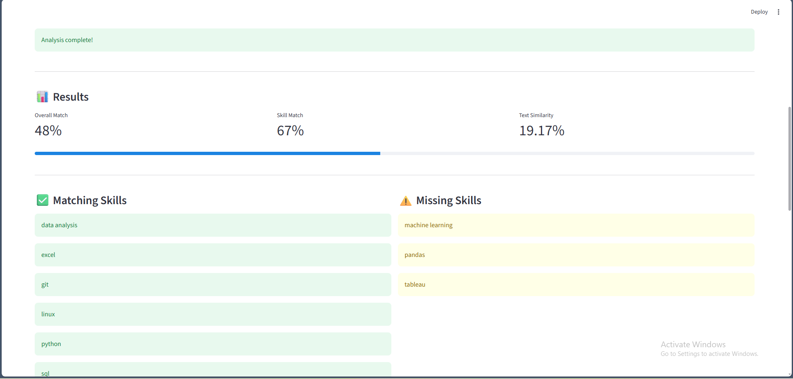

# AI Resume Analyzer

A Streamlit web app that scores how well a resume matches a job description, finds missing skills, and suggests improvements.



## What It Does

Upload a resume (PDF or DOCX), paste a job description, and the app:

- Extracts the resume text
- Detects technical skills in both the resume and the job description
- Calculates a **skill-match score** based on how many required skills the resume covers
- Calculates a **text-similarity score** using TF-IDF and cosine similarity
- Lists matching and missing skills
- Generates recommendations for improving the resume

## How the Score Works

| Step | What happens |
|---|---|
| 1. Text extraction | `pypdf` and `python-docx` read the uploaded resume |
| 2. Skill extraction | Technical skills are detected in both documents |
| 3. Skill matching | Resume skills are compared with the job's required skills |
| 4. TF-IDF | Both documents are converted into numerical vectors |
| 5. Cosine similarity | Measures how similar the two vectors are |
| 6. Final score | **60%** skill match + **40%** text similarity |

## Tech Stack

Python · Streamlit · scikit-learn (TF-IDF, cosine similarity) · pypdf · python-docx

## Run It

```bash
git clone https://github.com/Andrew-742001/ai-resume-analyzer.git
cd ai-resume-analyzer
pip install -r requirements.txt
streamlit run app.py
```

The app opens in your browser at `http://localhost:8501`.

## Run the Tests

```bash
pytest tests
```

## Project Structure

```
ai-resume-analyzer/
├── app.py          Streamlit interface and file text extraction
├── src/            skill extraction, matching, and scoring logic
├── tests/          unit tests
└── requirements.txt
```

## Next Steps

- Use semantic embeddings (for example, sentence-transformers) so related skills like "ML" and "machine learning" match
- Weight skills by how often or how prominently the job description mentions them
- Export the analysis as a PDF report

---

**Htet Aung Shinn** · [GitHub](https://github.com/Andrew-742001)